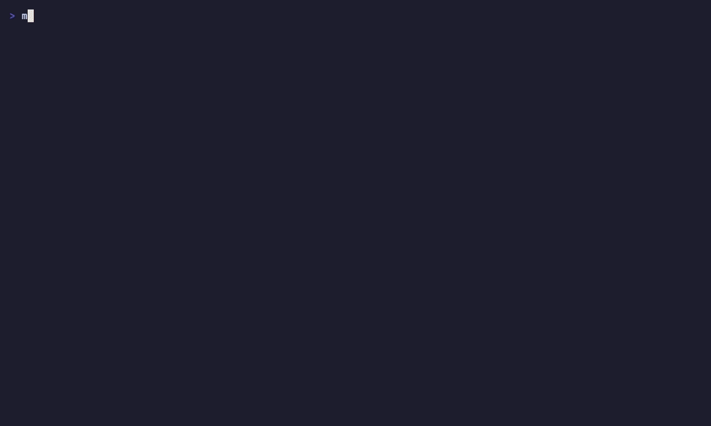
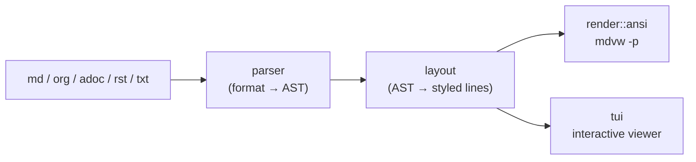

<h1 align="center">mdvw</h1>

<p align="center">
  A fast terminal viewer for <b>Markdown</b>, <b>Org</b>, <b>AsciiDoc</b>, <b>reStructuredText</b> and plain text.
</p>

<p align="center">
  <a href="https://github.com/qobulovasror/markdown-viewer/actions/workflows/ci.yml"></a>
  <a href="LICENSE"></a>
  
  
</p>

<p align="center">
  
</p>

`mdvw` renders documents with colors, tables, syntax-highlighted code and clickable links. Read them in
a full-screen viewer with a table of contents, search and live reload, or pipe the rendered text to
stdout. It is a single binary, starts in milliseconds and needs no configuration.

```sh
mdvw README.md        # read
mdvw docs/            # browse a folder
mdvw -w notes.md      # live reload while you edit
mdvw gh:owner/repo    # a GitHub README
mdvw -p x.md | less -R
```

## Why mdvw?

| | mdvw | glow | mdcat | bat |
|---|:-:|:-:|:-:|:-:|
| Rendered Markdown | ✅ | ✅ | ✅ | ❌ source only |
| Interactive full-screen viewer | ✅ | ✅ | ❌ | ❌ |
| Table of contents panel | ✅ | ❌ | ❌ | ❌ |
| Follow links between local documents | ✅ | ❌ | ❌ | ❌ |
| Live reload on file change | ✅ | ❌ | ❌ | ❌ |
| Inline images (Kitty / iTerm2 / Sixel) | ✅ | ❌ | ✅ | ❌ |
| Org, AsciiDoc, reStructuredText | ✅ | ❌ | ❌ | ❌ source only |
| Directory browsing | ✅ | ✅ | ❌ | ❌ |
| Syntax-highlighted code blocks | ✅ | ✅ | ✅ | ✅ |

<sub>Comparison as of 2026, based on each tool's default features.</sub>

## Features

- **Rendering**: headings, emphasis, inline code, lists (nested, ordered, task lists), tables
  with alignment and column fitting, block quotes, GitHub admonitions (`> [!NOTE]`), footnotes,
  definition lists, horizontal rules and front matter.
- **Code blocks** are syntax highlighted with bat's syntax set. The language comes from the fence or
  a shebang line.
- **Links** are clickable (OSC 8) in print mode. In the viewer, follow them with `Tab`/`Enter`.
  Local and web documents (`.md`, `.rst`, ... and GitHub `blob` links) open in place; `O` opens
  the focused link in the browser instead.
- **Remote documents**: `mdvw https://…/x.md`, `mdvw gh:owner/repo` or a `github.com` URL.
  Relative links inside them resolve against the web address. A local file or folder with the
  same name wins over a URL-like argument. Branch names containing `/` are not supported in
  `github.com/.../tree/<branch>` URLs.
- **Images** appear inline on Kitty, iTerm2, WezTerm, Ghostty and other graphics-capable terminals.
  Other terminals show `[🖼 alt]`.
- **Mermaid** flowcharts and sequence diagrams are drawn as box art in the terminal. Wide
  left-to-right charts switch to top-down when space is short. Other diagram types show their source.
- **Math**: `$\sum_{i=1}^n x_i^2$` renders as `∑ᵢ₌₁ⁿ xᵢ²`. Also **emoji** shortcodes (`:rocket:` → 🚀)
  and common inline HTML (`<kbd>`, `<sup>`, ``, `<a>`).
- **Viewer**: vim/less keys, regex search, link navigation with history, bookmarks, copy a code block,
  `$EDITOR` integration, a remembered reading position, focus (max-width) mode, a file panel and a
  fuzzy finder.
- **Themes**: `dark`, `light`, `dracula`, `nord` and `gruvbox`, plus your own (see
  Configuration). The default follows the terminal background. Colors fall back to 256/16 colors,
  and `NO_COLOR` is honored.

> [!TIP]
> Press `?` in the viewer to see every key, and `i` for document info and front matter.

## Install

```sh
cargo install mdvw                                                 # from crates.io
cargo install --git https://github.com/qobulovasror/markdown-viewer   # latest source
```

<details>
<summary><b>Shell completions and man page</b></summary>

```sh
mdvw --completions bash > ~/.local/share/bash-completion/completions/mdvw
mdvw --completions zsh  > ~/.zfunc/_mdvw           # add ~/.zfunc to $fpath
mdvw --completions fish > ~/.config/fish/completions/mdvw.fish
mdvw --man > ~/.local/share/man/man1/mdvw.1
```

Release archives already include `mdvw.1` and a `completions/` folder.

</details>

Prebuilt binaries for macOS, Linux and Windows are attached to
[GitHub releases](https://github.com/qobulovasror/markdown-viewer/releases). A Homebrew formula template
lives in [`packaging/mdvw.rb`](packaging/mdvw.rb).

## Usage

```sh
mdvw README.md                       # open the viewer
mdvw docs/                           # directory mode: file panel + README/index
mdvw -p README.md                    # print rendered output
mdvw -w notes.md                     # reload when the file changes
mdvw README.md#install               # open at a heading
mdvw a.md b.md c.md                  # several files: } next, { previous
mdvw https://example.com/notes.md    # a document on the web
mdvw gh:owner/repo                   # GitHub README (also github.com/owner/repo/...)
mdvw gh:owner/repo/docs/guide.md     # a file in a GitHub repository
curl -s https://example.com/x.md | mdvw
mdvw -p --width 80 --color always x.md | less -R
```

<details>
<summary><b>Command-line options</b></summary>

| Option | Description |
|---|---|
| `PATH...` | Files, a directory, a URL or `gh:owner/repo`; `file.md#heading` opens at a heading |
| `-p, --print` | Print to stdout instead of opening the viewer (default when stdout is not a terminal) |
| `-w, --watch` | Reload when the file changes |
| `-t, --theme <name>` | Color theme |
| `-f, --format <fmt>` | Input format: `md`, `org`, `adoc`, `rst`, `txt` |
| `--width <n>` | Print width / maximum text width in the viewer |
| `--toc` | Open the table of contents on start |
| `--color <when>` | `auto`, `always`, `never` |
| `--no-hyperlinks` | Disable OSC 8 links |
| `--no-config` | Ignore the config file |
| `--recent` | List recently opened files |
| `--completions <shell>` | Print completions for `bash`, `zsh`, `fish`, `elvish` or `powershell` |
| `--man` | Print the man page |

</details>

<details>
<summary><b>Keys</b></summary>

| Key | Action |
|---|---|
| `j` `k` `↓` `↑` | Scroll one line |
| `d` `u`, `Ctrl-d` `Ctrl-u` | Half page down / up |
| `Space` `b`, `PgDn` `PgUp` | Page down / up |
| `g` `G`, `Home` `End` | Top / bottom |
| *n* before a key | Repeat it (`5j`, `3]`); `42G` goes to line 42, `50%` to the middle |
| `]` `[` | Next / previous heading |
| `t` | Table of contents (`/` filters it, `h`/`l` move focus between panel and text) |
| `F` | File panel |
| `}` `{` | Next / previous file in the list or folder |
| `o`, `Ctrl-p` | Fuzzy find and open a file |
| `R` | Recently opened files |
| `S` | Search every file in the list or folder |
| `/` `n` `N` | Search (regex, smart-case), next / previous match; `↑` `↓` recall earlier searches |
| `Tab` `Shift-Tab` | Next / previous link |
| `Enter` | Open the focused link |
| `O` | Open the focused link in the browser / system app |
| `Backspace`, `Ctrl-o`, `H` / `L` | Go back / forward |
| `y` + `1-9`, `yy` | Copy code block *n* / the block on screen |
| `Y` | Copy the focused link, or a link to the current section |
| `W`, `←` `→` | Stop wrapping long code lines, then scroll them sideways |
| `m` + letter, `'` + letter | Set / jump to a bookmark |
| `e` | Edit in `$EDITOR` at the current heading (vim, nano, helix, emacs, VS Code, Zed, Sublime, ...) |
| `w` | Toggle watch mode (in a folder, the file list follows added and removed files) |
| `z` | Toggle focus width / full width |
| `T` | Cycle theme |
| `i` | Document info and front matter |
| `M` | Toggle mouse capture (to select text with the mouse) |
| `r` | Reload |
| `?` | Help |
| `Esc` | Clear the search, link focus or count |
| `q` | Quit |

The mouse wheel scrolls. Clicking a link opens it, and clicking a panel entry jumps to it. Links to
local files that mdvw cannot show (scripts, apps) ask for confirmation before they are opened.

Every key can be changed in the config file (see below).

</details>

<details>
<summary><b>Configuration</b></summary>

`~/.config/mdvw/config.toml` (or `$XDG_CONFIG_HOME/mdvw/config.toml`). Every key is optional:

```toml
theme = "nord"          # unset: auto light/dark
max_width = 100         # viewer text width, 0 = full width
mouse = true
watch = false
hyperlinks = true
toc = false             # open the table of contents on start
remember_position = true
images = true
wrap_code = true        # false: long code lines scroll sideways (← →) instead of wrapping
remote_images = false   # true: download web images (also those of web documents);
                        # documents can then make mdvw request any URL

[keys]                  # action = key or [keys]; replaces that action's defaults
quit = ["q", "esc"]
down = ["j", "down", "ctrl-n"]
```

Action names are listed in `mdvw --man` and the `?` screen. Keys are written like `j`, `G`,
`ctrl-d`, `alt-x`, `shift-tab`, `space`, `enter`, `esc`, `pagedown` or `f5`. Unknown keys and
actions are reported as warnings, not errors. Keys inside the contents and file panels
(`j` `k` `g` `G` `Enter` `Space` `l` `Esc` `Tab`) are fixed.

Reading positions and bookmarks are stored in `~/.local/state/mdvw/state.json`.

**Custom themes** live in `~/.config/mdvw/themes/<name>.toml` and are used with
`mdvw -t <name>`, `theme = "<name>"` or by cycling with `T`. Every key is optional:

```toml
base = "nord"                    # built-in theme to start from (default: dark)
syntax = "base16-ocean.dark"     # code highlighting theme
[colors]                         # #rrggbb
fg = "#d8dee9"                   # body text (unset keeps the base's choice)
muted = "#616e88"
surface = "#3b4252"              # code, status bar background
accents = ["#88c0d0", "#81a1c1"] # headings h1..h6 (the last one repeats)
code = "#ebcb8b"
link = "#88c0d0"
green = "#a3be8c"
yellow = "#ebcb8b"
red = "#bf616a"
blue = "#81a1c1"
purple = "#b48ead"
```

</details>

<details>
<summary><b>Troubleshooting</b></summary>

- **Colors look washed out.** Your terminal may not advertise truecolor. Try
  `COLORTERM=truecolor mdvw file.md`.
- **No images.** Images need a graphics protocol (Kitty, iTerm2, WezTerm, Ghostty, foot). They are
  disabled inside tmux. Web images are only downloaded with `remote_images = true`.
- **Can't select text with the mouse.** Press `M` to release mouse capture.
- **No colors at all.** Check that `NO_COLOR` is unset and stdout is a terminal. You can also force
  colors with `--color always`.

</details>

## Performance

Measured with `cargo bench` on a ~1 MB Markdown document (Apple Silicon, release build):

| Step | Time |
|---|---|
| Parse | ~18 ms |
| Layout (wrap, highlight, tables) | ~38 ms |
| Viewer start, small file | < 50 ms |

## How it works



Adding a format means writing one parser that produces the shared AST. Layout, themes and the viewer
work unchanged.

## Development

```sh
cargo test       # unit, snapshot and randomized tests
cargo bench      # parse/layout benchmarks
vhs assets/demo.tape   # regenerate the demo GIF
```

## License

[MIT](LICENSE)
