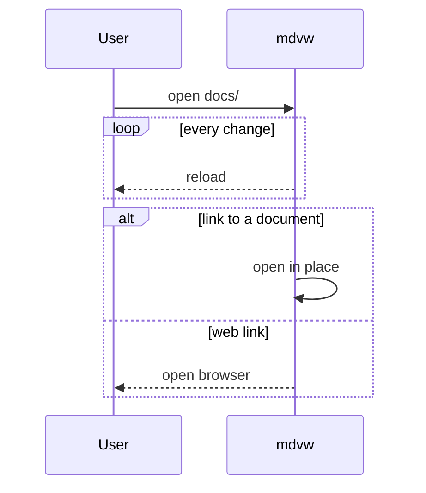

# Feature tour

A second document for the demo: long code lines, a sequence diagram and an HTML table.

## Long lines

Press `W` to stop wrapping, then `→` / `←` to scroll sideways.

```sh
curl -fsSL https://example.com/install.sh | sh -s -- --prefix "$HOME/.local" --with-completions --with-man-pages --channel stable
```

## Sequence



## HTML table

<table>
<tr><th>Key</th><th>Action</th></tr>
<tr><td>S</td><td>Search every file</td></tr>
<tr><td>R</td><td>Recent files</td></tr>
</table>
